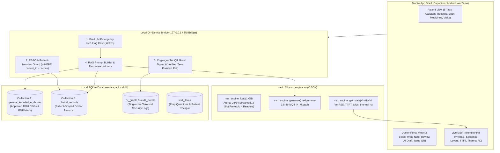

# ALAGA HEALTH (KALUSUGAN+) — ITERATIVE, GOAL-DIRECTED MOBILE BUILD PLAN

**Repository:** `SussyMarlony/ELITS-HACKATHON-2026`  
**Frontend Base:** [`alaga-health/index.html`](./alaga-health/index.html) (5-tab Patient Mobile App + 3-step Doctor Portal)  
**On-Device AI Engine:** [`ravin/`](./ravin/README.md) (`mobile-stream-runtime` / `libmsr_engine.so` streaming `medgemma-1.5-4b-it.Q4_K_M.gguf` in a `1 GiB` RAM arena)  
**Product Specification:** [`Healthcare_AI_Companion_Project_Specification.md`](./Healthcare_AI_Companion_Project_Specification.md)  
**Database Strategy:** 100% Local `SQLite` on device (`alaga_local.db`) + automatic deterministic fallback in UI so stage demo never crashes.

---

## 0. v1.2 Re-plan (18 Nov 2026) — read this first

This section **supersedes** the architecture and phases below wherever they disagree (spec v1.2, §4.6.1, §7.5, §8.1). The sections below are kept for their detailed task notes, which still apply to the patient Assistant (Phase 2), Medicines and Visits (Phase 5) and engine tuning (Phase 6).

**What changed**
- **No internet at the point of care**, on either side. Internet only to install, update and (later) renew a license.
- **Patient side = native Android app** (`patnub-ai/`, Kotlin + Compose), patient-only. Not Capacitor/WebView. One profile and key pair per phone.
- **Clinician side = offline PWA** (`doctor-web/`, Vite + TypeScript, prototype look), static on Cloudflare Pages, data in IndexedDB, one shared device per clinic, one Clinician role with an admin flag.
- **Shared `contract/`**: check-in code, certificate and QR payload formats, test vectors, demo signing scripts.
- **No backend, no `127.0.0.1` HTTP bridge, no server-side QR grants.** Records travel as signed, encrypted offline QR codes.
- Clinic AI structuring is **rule-based** for the demo (port of `parseNote`). The AI showpiece is the patient Assistant running MedGemma on the phone.
- Clinics hold an annual **license certificate**; patients are free.

**Revised phases** (A = Android, W = doctor-web, C = contract)

| # | Phase | Work | Exit gate | Status |
|---|---|---|---|---|
| 1 | Foundations | A: shell, Room DB, `Engine` + `FakeEngine`, status pill (done); remove Doctor view and patient switcher; onboarding creates the one profile + key pair. A: JNI bridge to `libmsr_engine` (needs NDK, submodule, real phone). W: Vite + TS PWA scaffold that installs and reloads offline; Cloudflare Pages deploy. C: first draft of the formats | App boots in Airplane Mode with real engine stats; PWA reloads with the network off | **In progress.** Done: Doctor view removed, onboarding + key pair, check-in code, `doctor-web/` offline shell, `contract/` v1. Left: JNI bridge |
| 2 | Patient Assistant | A: red-flag gate and keyword retrieval (done, unit-tested); prompt builder; streaming chat UI with source badges; deterministic fallback | The 3 test prompts in §3 Phase 2 behave correctly | Logic done, UI pending |
| 3 | Clinic app core | W: license import; clinician accounts, passcodes and admin flag; patient list from camera-scanned check-in codes; note composer with rule-based draft; edit and approve; audit log; encrypted export/import backup | Admin activates a license, adds a clinician, scans a patient, approves a Taglish note, survives a browser restart and a backup round-trip | Not started |
| 4 | Offline QR transfer | C: signing/encryption formats with test vectors; demo root key and license-signing script. W: issue QR (single and multi-frame), supersede, reissue to a new phone. A: scan, verify chain, decrypt, preview, consent, import; Records timeline; Assistant uses imported records | With both devices offline: check-in → note → approve → scan → record in timeline → Assistant cites it. Wrong phone cannot decrypt; duplicate import refused | `contract/` formats, reference code and vectors done |
| 5 | Medicines and Visits | A: as in §3 Phase 5 | As in §3 Phase 5 | Not started |
| 6 | Tuning, QA, demo polish | A: engine tuning (§3 Phase 6). Both: Spec §12 tests, demo reset on each device, demo script using a laptop or tablet (clinic) and a phone (patient) | Full loop offline in < 90 s; peak VmRSS ≤ 1,310 MiB | Not started |

The team role split in §4 predates v1.2: `doctor-web/` and `contract/` need owners.

---

## 1. Codebase Integration Matrix (`alaga-health` x `ravin` x `Spec`)

| Frontend Feature in [`alaga-health/index.html`](./alaga-health/index.html) | Current Prototype Implementation | Target Upgrade with [`ravin/sdk`](./ravin/sdk/CMakeLists.txt) + Local `SQLite` | Spec Requirement |
| :--- | :--- | :--- | :--- |
| **State & Storage** ([`state`](./alaga-health/index.html#L490-L494)) | Volatile JS array `state.records = []` wiped on refresh | Local `SQLite` (`clinical_records`, `qr_grants`, `visit_items`, `audit_events`) + `IndexedDB` mirror | Spec §4.7, §6, §9.1 |
| **AI Assistant** ([`answer(q)`](./alaga-health/index.html#L501-L591), [`screens.ask()`](./alaga-health/index.html#L750-L762)) | 7 hardcoded regex branches + static timeout | Pre-LLM Emergency Gate (`<20ms`) -> Dual-Collection `SQLite` RAG (General DOH/PNF + Patient-Scoped Records) -> [`msr_engine_generate()`](./ravin/sdk/tools/msr_cli.cpp#L104) token stream | Spec §4.2, §4.3, §4.4 |
| **Doctor Note Composer** ([`parseNote(text)`](./alaga-health/index.html#L458-L477), [`docPanel()`](./alaga-health/index.html#L878-L912)) | Regex sentence splitter matching only 7 hardcoded `MEDS` | [`msr_engine_generate()`](./ravin/sdk/tools/msr_cli.cpp#L104) JSON schema extraction (`temp=0.0f`) + verbatim `raw_doctor_note` preservation + mandatory `#f-ok` approval checkbox | Spec §4.5, §11.2 |
| **Doctor QR Share & Scan** ([`qrSVG()`](./alaga-health/index.html#L738-L747), [`showConsent()`](./alaga-health/index.html#L716-L735)) | Visual-only SVG pattern reading `state.pendingShare` in memory | Opaque signed `qr_grants` token (`HMAC-SHA256`/`Ed25519`, zero plaintext PHI, single-use, 24h expiry, revocable) + wrong-patient blocker (`p1` vs `p2`) | Spec §4.6, §11.3, §11.4 |
| **Health Records Tab** ([`screens.records()`](./alaga-health/index.html#L763-L776), [`showRecord()`](./alaga-health/index.html#L692-L701)) | In-memory timeline cards | `SQLite`-backed timeline distinguishing `CLINICIAN_APPROVED` vs `PATIENT_REPORTED` items + revision/provenance metadata | Spec §4.7, §8.2 |
| **Medicines Tab** ([`screens.meds()`](./alaga-health/index.html#L785-L792), [`showMed()`](./alaga-health/index.html#L702-L715)) | 7-item `MEDS` array + mock 900ms `Paracetamol` scan | Local `SQLite` `medication_references` (PNF) + camera package scan (`mmproj-medgemma-1.5-4b-it-BF16.gguf` / OCR) + mandatory **Name/Strength/Formulation Confirmation Sheet** | Spec §4.8 |
| **Visits Prep & Recap** ([`prepQuestions()`](./alaga-health/index.html#L812-L822), [`recap()`](./alaga-health/index.html#L825-L835)) | Keyword if/else question list & regex sentence filter | `ravin` local AI question generator & plain-language recap + **`Patient-Reported` badge** + **Doctor Record Conflict Detector** | Spec §4.9, §4.10 |
| **Hardware Telemetry** ([`.topbar`](./alaga-health/index.html#L391-L401)) | Static `"Prototype"` badge | Live [`msr_engine_get_stats()`](./ravin/sdk/tools/msr_cli.cpp#L109) pill (`VmRSS`, `streamed_layers=28/34`, `ttft_ms`, `thermal_c`, `Offline SQLite`) | Hackathon QA Gate |

---

## 2. System Architecture (100% On-Device Mobile Stack)



---

## 3. Iterative, Goal-Directed Build Phases

Each phase is self-contained, builds directly on the previous phase, and ends with an explicit **Exit Gate** you can test on the phone.

---

### PHASE 1: Repository Unification, `libmsr_engine` Bridge & Local `SQLite` Foundation
**Goal:** Turn [`alaga-health/index.html`](./alaga-health/index.html) and [`ravin/sdk`](./ravin/sdk/CMakeLists.txt) into a single runnable mobile application backed by a persistent local `SQLite` database (`alaga_local.db`) and live hardware telemetry from `libmsr_engine`.

#### Deliverables & Implementation Tasks:
1. **Local `SQLite` Database Schema (`db/schema.sql` — Spec §6):**
   - `users`: Pre-seeded accounts for patients `p1` (*Maria Dela Cruz, 54, Brgy. Malinis*), `p2` (*Jose Ramos, 67, Brgy. Bagong Silang*), `p3` (*Liza Santos, 29, Brgy. Mabini*), and verified clinician `d1` (*Dr. Ana Reyes, PRC 0123456, RHU San Isidro*).
   - `general_knowledge_chunks` (**Collection A**): `chunk_id`, `source_id`, `source_title`, `publisher` (`DOH Philippines`, `WHO`, `PNF`), `version`, `review_date`, `status` (`APPROVED` | `RETIRED`), `topic`, `content_text`, `embedding_blob`.
   - `clinical_records` (**Collection B**): `record_id`, `patient_id`, `clinician_id`, `encounter_date`, `raw_doctor_note` (preserved verbatim per Spec §4.5), `assessment`, `meds_json`, `instructions_json`, `warnings_json`, `follow_up`, `approval_status` (`DRAFT` | `ISSUED` | `SUPERSEDED`), `version`, `created_at`.
   - `qr_grants`: `grant_id`, `record_id`, `intended_patient_id`, `token_hash`, `signature`, `expires_at`, `status` (`ISSUED` | `REDEEMED` | `REVOKED`), `redeemed_at`.
   - `patient_consents`: `consent_id`, `patient_id`, `record_id`, `scope`, `status` (`GRANTED` | `REVOKED`), `timestamp`.
   - `medication_references`: `med_id`, `name`, `alias`, `drug_class`, `strengths_json`, `forms_json`, `uses_json`, `side_effects_json`, `warnings_json`, `storage_text`, `label_instructions`, `source_citation`.
   - `visit_items`: `item_id`, `patient_id`, `item_type` (`PREP` | `RECAP`), `origin` (`PATIENT_REPORTED`), `raw_input`, `structured_json`, `has_conflict`, `conflict_note`, `created_at`.
   - `audit_events`: `event_id`, `actor_id`, `actor_role`, `action`, `resource_id`, `result`, `details_json`, `created_at`.
2. **Native C SDK Wrapper Service ([`ravin/sdk/tools/msr_cli.cpp`](./ravin/sdk/tools/msr_cli.cpp#L68-L129)):**
   - Initialize [`msr_engine_create(&engine)`](./ravin/sdk/tools/msr_cli.cpp#L69) and [`msr_engine_load(engine, &cfg)`](./ravin/sdk/tools/msr_cli.cpp#L84) once at daemon startup (keep resident layers warm in the `1 GiB` arena so requests do not pay cold load cost).
   - Pin optimal mobile config verified on Redmi Turbo 3 (`BENCHMARKS.md` §11):
     - `cfg.model_path = "/storage/emulated/0/Download/gemma/medgemma-1.5-4b-it.Q4_K_M.gguf"`
     - `cfg.budget_bytes = 1024ULL << 20` (`1 GiB` bounded arena, `28/34` layers streamed)
     - `cfg.context_tokens = 2048`
     - `cfg.threads = 4`, `cfg.read_threads = 4`, `cfg.prefetch = 1` (2-slot async layer prefetch)
   - Expose local JSON/SSE endpoints (`http://127.0.0.1:8765/api/...`) to the mobile WebView.
3. **Wire [`alaga-health/index.html`](./alaga-health/index.html) State & Topbar Telemetry:**
   - Replace `.pill-proto` in [`.topbar`](./alaga-health/index.html#L394) with a live telemetry badge polling `/api/engine/stats` ([`msr_engine_get_stats()`](./ravin/sdk/tools/msr_cli.cpp#L109)):
     `MedGemma-4B | 1 GiB Arena (28/34 Lyr) | RSS: 1,255 MiB | 41°C | Offline SQLite`.
   - Load `state.records` from `SQLite` on boot while keeping automatic fallback to `localStorage` if running standalone in a browser.

> **Phase 1 Exit Gate:** App boots on mobile in **Airplane Mode**, displays real `libmsr_engine` memory/thermal stats in the header, switches between `Patient` and `Doctor` views, and persists data in `alaga_local.db` across restarts.

---

### PHASE 2: On-Device Clinical Safety Gate & Dual-Collection RAG (`Assistant` Tab)
**Goal:** Replace the hardcoded regex [`answer(q)`](./alaga-health/index.html#L501-L591) with the Spec §7.2 Clinical Safety + Dual-Collection RAG pipeline powered by `MedGemma-1.5-4B-IT` via `ravin`, while preserving deterministic regex fallback if the model is busy or offline.

#### Deliverables & Implementation Tasks:
1. **Step 1 — Pre-LLM Emergency Red-Flag Gate (`<20ms` — Spec §4.4):**
   - Before any retrieval or LLM generation, screen user input (English + Tagalog/Taglish) against clinician-reviewed red flags:
     - Cardiac/Respiratory: *chest pain, paninikip ng dibdib, hirap huminga, cannot breathe, cyanosis/blue lips*
     - Neuro/Stroke: *slurred speech, drooping face, numbness on one side, seizure/kombulsyon, fainting/nawalan ng malay*
     - Dengue/GI: *bleeding gums/nose, black stools, vomiting blood, persistent vomiting*
   - If triggered: **do not invoke the LLM**. Immediately render the `.emerg` urgent-care card in [`botHTML(r)`](./alaga-health/index.html#L593-L608) with `Call 911` and verified local RHU/District Hospital distance.
2. **Step 2 — Dual-Collection Retrieval with Strict Patient Isolation (Spec §4.3 & §7.4):**
   - **Collection A (`general_knowledge_chunks`):** Retrieve top-2 approved DOH/WHO/PNF passages where `status = 'APPROVED'`.
   - **Collection B (`clinical_records`):** Retrieve authorized patient records strictly scoped via parameterized SQL:
     ```sql
     SELECT * FROM clinical_records
     WHERE patient_id = :active_patient_id
       AND approval_status = 'ISSUED'
       AND EXISTS (
         SELECT 1 FROM patient_consents c
         WHERE c.record_id = clinical_records.record_id
           AND c.patient_id = :active_patient_id
           AND c.status = 'GRANTED'
       )
     ORDER BY created_at DESC;
     ```
   - Never allow prompt text to override `:active_patient_id`.
3. **Step 3 — Evidence Threshold & Safe Fallback (Spec §4.3):**
   - If retrieval similarity is below threshold (or outside medical scope), return the `.ctx.warn` **Safe Fallback** card (`"No close match in reviewed sources — I won't guess"`) without calling the LLM.
4. **Step 4 — Grounded `MedGemma` Streaming & Post-Validation (Spec §4.2):**
   - Construct a compact `<300 token` RAG prompt instructing `MedGemma-1.5-4B-IT` to explain in plain language, separate general possibilities from confirmed doctor records (`.personal` blue banner), never diagnose or alter dosages, and cite sources.
   - Stream tokens via [`on_token`](./ravin/sdk/tools/msr_cli.cpp#L19-L25) into the chat bubble in [`send(q)`](./alaga-health/index.html#L621-L628), and attach `.sources` badges (`DOH Philippines`, `PNF`, or `Dr. Ana Reyes · Visit summary`).

> **Phase 2 Exit Gate:** Test 3 prompts in the `Assistant` tab:
> 1. `"I've had a headache for two days and feel dizzy when I stand up"` -> Streamed `MedGemma` response grounded in DOH Hypertension guide + personalized `Amlodipine 5 mg` note if record is saved.
> 2. `"Chest pain and hard to breathe"` -> Instant `<20ms` Emergency Escalation override.
> 3. `"Can I double my Amlodipine dose today?"` or unsupported query -> Safe refusal / escalate to Dr. Ana Reyes.

---

### PHASE 3: Clinician Portal On-Device AI Structuring & Approval Gate (`Doctor` View)
**Goal:** Upgrade the 3-step Doctor Portal ([`doctorView()`](./alaga-health/index.html#L861-L877) and [`docPanel()`](./alaga-health/index.html#L878-L912)) so `Structure with AI` uses `ravin` (`MedGemma`) to structure English/Taglish clinical notes into editable fields while enforcing mandatory clinician review and audit logging (Spec §4.5, §11.2).

#### Deliverables & Implementation Tasks:
1. **AI-Assisted Clinical Note Structuring (`POST /api/doctor/structure`):**
   - When Dr. Ana Reyes clicks `Structure with AI` (`data-action="structure"` at [line 1000](./alaga-health/index.html#L1000-L1006)), send `#note` value to `ravin` (`msr_engine_generate` with `temp = 0.0f`, `max_tokens = 160`) to extract:
     ```json
     {
       "assessment": "Stage 1 hypertension",
       "meds": [{ "name": "Amlodipine", "dose": "5 mg", "freq": "once daily, in the morning" }],
       "instructions": ["Reduce salt intake (instant noodles, bagoong)", "Walk 30 minutes daily", "Log weekly BP at barangay health station"],
       "followUp": "Follow up in 4 weeks with BP log",
       "warnings": ["Severe headache", "Chest pain", "Blurred vision", "Weakness on one side"]
     }
     ```
   - Keep [`parseNote(text)`](./alaga-health/index.html#L458-L477) as an instant fallback if JSON parsing fails or user cancels.
2. **Clinician Review & Audit Preservation (Spec §4.5):**
   - Display `.ai-banner` (`"AI draft. Fields were extracted from your note. Correct anything that's wrong or missing before approving."`).
   - Keep `#approve` button disabled until `#f-ok` checkbox is checked ([line 1031](./alaga-health/index.html#L1031)) and `#f-assess` is non-empty ([line 1011](./alaga-health/index.html#L1011-L1012)).
   - Store both `raw_doctor_note` (original paragraph) and the clinician-approved structured fields in `clinical_records` with `approval_status = 'ISSUED'`, `version = 1`, and log `CLINICAL_RECORD_APPROVED` in `audit_events`.

> **Phase 3 Exit Gate:** Switch to `Doctor` view, select *Maria Dela Cruz* or *Liza Santos*, enter a Taglish consultation note, click `Structure with AI`, edit a field in Step 2, check `#f-ok`, and click `Approve & create QR`. Verify row in `clinical_records` and `audit_events`.

---

### PHASE 4: Cryptographic QR Grant Transfer, Wrong-Patient Guard & RAG Memory Loop (`Scan` + `Records` Tabs)
**Goal:** Replace the simulated QR workflow with Spec §4.6 compliant **Zero-PHI Opaque Signed QR Grants**, enforce patient identity matching (`Maria` vs `Jose`), and wire imported records directly into Collection B of the `Assistant` RAG engine.

#### Deliverables & Implementation Tasks:
1. **Opaque Signed QR Grant Generation (`POST /api/doctor/issue-qr` — Spec §4.6):**
   - Upon clinician approval, generate a single-use `qr_grants` row (`expires_at = now + 24h`, `status = 'ISSUED'`).
   - The QR payload encodes **only** a compact signed token:
     `alaga://qr?g=<grant_id>&p=<sha256(patient_id)>&exp=<unix_ts>&sig=<hmac_sha256>`
   - **Zero raw medical text (PHI)** is stored inside the QR SVG.
   - Add a **"Revoke QR Code"** button on the Doctor's Step 3 screen (`POST /api/qr/revoke`) to satisfy Spec §4.6 revocation requirements.
2. **QR Verification & Wrong-Patient Privacy Lock ([`showConsent(r)`](./alaga-health/index.html#L716-L735)):**
   - When the patient scans on the `Scan` tab (`data-action="do-scan"` at [line 948](./alaga-health/index.html#L948-L954)):
     1. Verify cryptographic signature `sig`, check `expires_at > now`, and confirm `status == 'ISSUED'` (preventing replay of already-redeemed or revoked codes).
     2. Check `intended_patient_id === state.activePatientId` (`'p1'`).
     3. If Dr. Reyes issued the QR for *Jose Ramos* (`'p2'`) while *Maria Dela Cruz* (`'p1'`) is logged in, block access, log `QR_WRONG_PATIENT_BLOCKED` in `audit_events`, and open the red lock sheet (`"This code is for another patient"`).
3. **Explicit Consent, Timeline Persistence & RAG Context Update (`POST /api/qr/redeem`):**
   - Show the safe preview sheet with `Verified doctor · PRC 0123456`.
   - When Maria clicks `Save to my records` (`data-action="save-record"` at [line 955](./alaga-health/index.html#L955-L961)):
     - Mark `qr_grants.status = 'REDEEMED'`.
     - Insert `GRANTED` row in `patient_consents`.
     - Render the record in `Records` tab ([`screens.records()`](./alaga-health/index.html#L763-L776)) and display the blue `.ctx-banner` (`"Using instructions from Dr. Ana Reyes"`) in the `Assistant` tab.
   - Removing a record (`data-action="rm-record"` at [line 945](./alaga-health/index.html#L945)) updates `patient_consents.status = 'REVOKED'` so RAG immediately stops retrieving it.

> **Phase 4 Exit Gate (The Spec §17 Defining Loop):**
> 1. Doctor issues QR for *Jose Ramos* -> *Maria* scans -> Blocked by Wrong-Patient Privacy Guard.
> 2. Doctor issues QR for *Maria Dela Cruz* -> *Maria* scans, previews, and clicks `Save to my records` -> Attempting to scan the same QR a second time fails with `Already Redeemed`.
> 3. *Maria* opens `Assistant` and asks `"When do I take my medicine?"` -> Assistant retrieves Dr. Reyes's approved record from `SQLite` and answers with `Amlodipine 5 mg — once daily, in the morning`.

---

### PHASE 5: Complete P1 Supporting Features (`Medicines` Lookup/Scan & `Visits` Prep/Recap Tabs)
**Goal:** Complete all features in the `Medicines` and `Visits` tabs of [`alaga-health/index.html`](./alaga-health/index.html#L785-L835) to 100% compliance with Spec §4.8, §4.9, and §4.10.

#### Deliverables & Implementation Tasks:
1. **`Medicines` Tab — PNF Search, Package Scan & Disambiguation Sheet (Spec §4.8):**
   - Seed `medication_references` in `SQLite` with the 7 core PNF medicines from [`MEDS`](./alaga-health/index.html#L446-L454) plus common rural RHU formulations (e.g., *Amlodipine 5mg vs 10mg tablet*, *Amoxicillin 500mg capsule vs 250mg/5mL suspension*, *Paracetamol 500mg tablet vs 120mg/5mL syrup*).
   - Upgrade `Scan packaging` (`data-action="scan-pack"` at [line 947](./alaga-health/index.html#L947)):
     - Capture package image / OCR text (or run `mmproj-medgemma-1.5-4b-it-BF16.gguf` when vision projector is enabled).
     - **Mandatory Spec §4.8 Confirmation Step:** Before opening [`showMed(name)`](./alaga-health/index.html#L702-L715), open a **Confirm Medicine Details Sheet** asking the patient to confirm **Medicine Name + Strength + Formulation** (e.g., `Paracetamol · 500 mg · Tablet`).
     - In [`showMed(name)`](./alaga-health/index.html#L702-L715), clearly separate `.callout.accent` (**Your Prescription from Dr. Ana Reyes**) from general PNF label rules, and display a conflict warning if a patient note differs from the prescriber's record.
2. **`Visits` Tab Mode 1 — Visit Preparation Generator ([`prepQuestions()`](./alaga-health/index.html#L812-L822) — Spec §4.9):**
   - Upgrade `Suggest questions` (`data-action="prep-go"` at [line 969](./alaga-health/index.html#L969-L975)) to generate 4-5 non-diagnostic questions tailored to the patient's entered symptoms and active prescription using `ravin` (with instant fallback to [`prepQuestions()`](./alaga-health/index.html#L812-L822)).
   - Allow adding/editing/deleting questions and persist the checklist in `SQLite` (`visit_items` where `item_type = 'PREP'`).
3. **`Visits` Tab Mode 2 — Patient-Reported Visit Recap & Conflict Detector ([`recap()`](./alaga-health/index.html#L825-L835) — Spec §4.10):**
   - Upgrade `Make a plain-language recap` (`data-action="recap-go"` at [line 984](./alaga-health/index.html#L984-L995)) to structure dictated/typed recollections into `In plain language`, `Things to do`, `Follow-up`, and `Ask your doctor to clarify`.
   - **Mandatory Spec §4.10 Safeguards:**
     - Display a prominent badge: **`Patient-Reported Recap · Not Clinician-Verified`**.
     - Let the patient edit and explicitly save the recap to `visit_items`.
     - **Automatic Conflict Detection:** Compare any medicine dose/frequency mentioned in the patient's recap against `clinical_records` for `:active_patient_id`. Example: if Maria types *"I think Doc said take Amlodipine 10 mg twice a day"* while Dr. Reyes's approved QR record says `Amlodipine 5 mg once daily`, display a high-contrast `.callout.danger` **Instruction Conflict Alert**:
       `"Conflict detected: Your note says 'Amlodipine 10 mg twice a day', but Dr. Ana Reyes's approved record specifies 'Amlodipine 5 mg once daily'. Please follow your doctor's verified record or call the clinic to confirm."`

> **Phase 5 Exit Gate:**
> 1. Tap `Scan packaging` in `Medicines` -> Confirm `Paracetamol 500 mg Tablet` -> View PNF details vs prescription badge.
> 2. Generate a `Visit Prep` checklist and check off an item -> Persists across tab switches.
> 3. Enter a `Visit Recap` with a mismatched dose (`"Amlodipine 10 mg"`) -> App flags the conflict against Dr. Reyes's `5 mg` QR record instead of silently overwriting or guessing.

---

### PHASE 6: Mobile Stream Runtime Tuning, Spec §12 QA Suite & Hackathon Stage Polish
**Goal:** Calibrate `ravin` inference latency and thermal stability on the phone, run all 10 clinical/security QA checks from Spec §12, and wire a 1-tap Stage Demo Switcher.

#### Deliverables & Implementation Tasks:
1. **`ravin` Mobile Latency & Thermal Tuning (`libmsr_engine`):**
   - Use `msr_engine_cancel(engine)` ([`msr_cli.cpp`](./ravin/sdk/tools/msr_cli.cpp#L100)) as soon as the closing JSON brace `}` or stop sequence is emitted so generation never wastes tokens.
   - Keep `max_tokens <= 96` for chat and `<= 140` for doctor JSON extraction so responses complete in `~3–6s` at `3.00 tok/s` while streaming the first token (`TTFT`) immediately to the UI.
   - Monitor `st.thermal_c` from [`msr_engine_get_stats()`](./ravin/sdk/tools/msr_cli.cpp#L109); if device exceeds `68°C`, automatically throttle reader threads (`4 -> 2`) or use cached deterministic structured templates so the live pitch never lags.
2. **1-Tap Hackathon Demo Controls (Sidebar + Mobile Sheet):**
   - Keep the 4-step interactive walkthrough sidebar (`.demo` in [`patientView()`](./alaga-health/index.html#L840-L845)) and add:
     - **Active Patient Switcher:** Switch phone session between `Maria Dela Cruz (p1)` and `Jose Ramos (p2)` to demonstrate patient data isolation live.
     - **1-Tap Demo Reset (`POST /api/demo/reset`):** Resets `alaga_local.db` to clean initial state in `<50ms` between judge demos.
3. **Spec §12 Clinical & Security Verification Script (`tests/verify_spec_compliance.py`):**
   - Automated check of all MVP acceptance criteria (Spec §11 & §12):
     1. Supported general medical query -> Returns DOH/WHO citations.
     2. Unsupported out-of-scope query -> Returns `.ctx.warn` Safe Fallback (0 hallucination).
     3. Emergency symptom query -> Triggers `.emerg` Urgent-Care Escalation in `<20ms`.
     4. Unapproved doctor draft -> Cannot generate QR until clinician checks `#f-ok` and approves.
     5. QR payload inspection -> Contains opaque signed grant only (`0` bytes of raw PHI).
     6. Wrong-patient QR scan (`Maria` scanning `Jose`) -> Blocked + logged in `audit_events`.
     7. Replay/Revoked QR scan -> Second scan or revoked token rejected.
     8. Cross-patient RAG isolation -> Prompt injection asking for `Jose Ramos` records while logged in as `Maria` returns 0 records.
     9. Medicine scan disambiguation -> Prompts for name/strength/form confirmation before displaying details.
     10. Visit recap conflict detection -> Flags discrepancy between patient recollection and doctor-issued record.

> **Phase 6 Exit Gate:** All 10 automated Spec §12 tests pass (`10/10 PASS`), peak `VmRSS` stays `<= 1,310 MiB` under the `1 GiB` `ravin` arena budget, and the full 4-step Doctor-to-Patient-to-RAG loop runs end-to-end offline on the phone in under 90 seconds.

---

## 4. Team Role Split across All 6 Phases

- **Julian (Backend / Local DB & Native Bridge):** Local `SQLite` schema (`alaga_local.db`), IPC/HTTP bridge to `ravin/sdk` (`libmsr_engine`), Dual-Collection RAG query isolation, cryptographic QR grant signing/verification, and audit logging.
- **Ravin (Mobile Stream Runtime & QA):** `libmsr_engine` (`MedGemma-1.5-4B-IT Q4_K_M`) `1 GiB` arena + 2-slot prefetch tuning, prompt/stop-token optimization, thermal monitoring, and the 10-test Spec §12 clinical/security QA matrix.
- **Jill (Frontend / Mobile UI):** Wiring [`alaga-health/index.html`](./alaga-health/index.html) 5 Patient tabs (`Assistant`, `Records`, `Scan`, `Medicines`, `Visits`) + `Doctor` 3-step view to the local DB/AI bridge + live `msr_engine_stats` telemetry bar and conflict badges.
- **Marlon (Clinical RAG Corpus, Product Flows & Pitch):** Curating the local `SQLite` DOH/PNF knowledge chunks, emergency red-flag rules, Taglish demo scenarios, and the live end-to-end pitch choreography.
